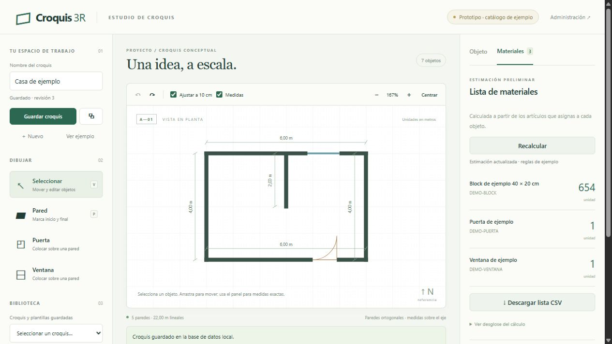
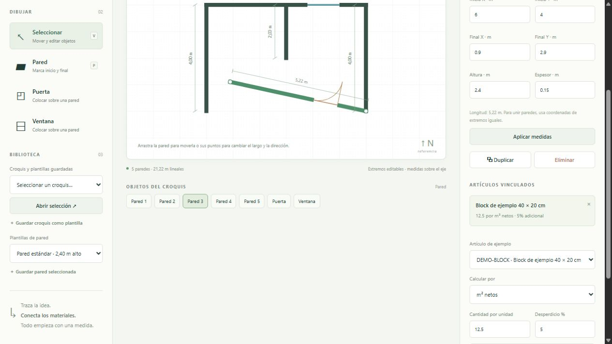
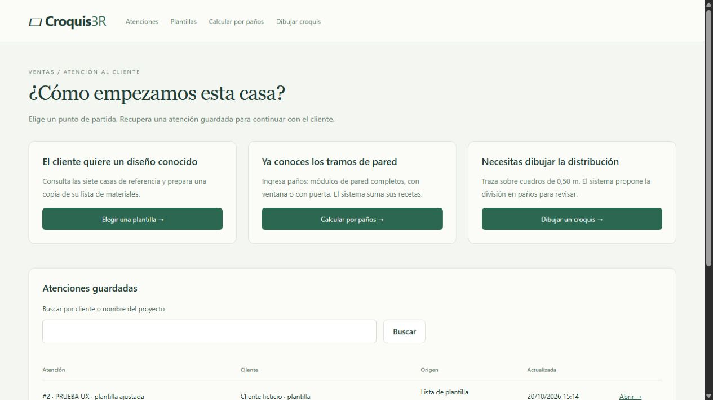

# Verificación del prototipo — 2026-10-19

- Python 3.12.14 / Django 5.2.18, Windows, SQLite local.
- `manage.py check`: sin incidencias.
- `manage.py makemigrations --check --dry-run`: sin cambios pendientes.
- `manage.py test sketches catalog`: 12 pruebas aprobadas.
- `node --test tests/geometry.test.mjs`: 4 pruebas aprobadas.
- `node --check src/static/croquis/editor.js`: aprobado.
- `pip check`: sin dependencias rotas.
- Migraciones iniciales y `seed_demo`: ejecutados correctamente sobre base local.
- `collectstatic`: ejecutado correctamente; Docker lo repite al construir la imagen.
- HTTP `/` y `/health/`: 200.
- Docker Compose 5.6.0, descarga oficial con SHA-256 comprobado: `config --quiet` aprobó configuración local y combinación de producción. Se verificó red backend interna, ausencia de puertos publicados en producción y montaje PostgreSQL 18 en `/var/lib/postgresql`.

## Pruebas en navegador

Se comprobó el trazo de una pared de 2 m con dos clics, deshacer, duplicación de pared con su puerta, guardado y recuperación de un croquis, plantilla de pared y apertura de plantilla de croquis como copia nueva. El ejemplo produjo 654 blocks, 1 puerta y 1 ventana con sus reglas ficticias. No hubo errores ni advertencias de consola en la revisión final.

Los objetos de prueba agregados se deshicieron antes de guardar el ejemplo final. Quedaron en la base local una casa de ejemplo, una plantilla de casa y una plantilla de pared para facilitar la revisión. Son datos de demostración, no expedientes de clientes.

## Pendiente

La construcción y ejecución real de los contenedores y las pruebas contra PostgreSQL 18 no se realizaron: la VM QEMU de esta sesión no expone virtualización anidada y no tiene WSL. Compose se usó únicamente para validar configuración. No se instaló Docker Desktop, no se reinició Windows ni se modificó el anfitrión de la VM.

Faltan validación de reglas con TicoBlock, conexión al catálogo real y preparación operativa del despliegue. No se accedió al servidor de producción ni se configuraron respaldos.

## Cambio: extremos arrastrables — 2026-10-19

Los puntos de inicio y final ahora permiten redimensionar y rotar la pared, manteniendo fijo el extremo opuesto. Admiten ajuste a cuadrícula y a extremos de otras paredes, área de interacción ampliada y cancelación con Escape. Las aberturas conservan su anclaje y no se permite reducir el largo por debajo de su extremo más lejano.

Se amplió el cálculo del servidor a longitud euclídea, la validación de superposiciones a líneas inclinadas y las cotas a tramos diagonales contiguos. La duplicación de una pared inclinada utiliza un desplazamiento perpendicular.

- 15 pruebas Django aprobadas, incluyendo cálculo y persistencia de paredes inclinadas con aberturas.
- 8 pruebas de geometría aprobadas, incluyendo ambos extremos, ajuste, largo mínimo, cotas diagonales y duplicación.
- Sintaxis JavaScript aprobada.
- Se arrastraron ambos puntos en navegador y se verificó que el extremo opuesto queda fijo, la cota cambia y la puerta sigue la pared. Se comprobó deshacer; sin errores de consola. La prueba se hizo en una pestaña separada para conservar el trabajo abierto del usuario.

## Pruebas de flujo para vendedores — 20 de octubre de 2026

### Dictamen sobre sustituir los Excel

**El sistema está preparado para un piloto del cálculo manual de casas y de las listas de diseños recibidas, con cotejo del resultado. Todavía no se recomienda retirar los Excel.** La web reproduce las 17 recetas recibidas y agrega captura guiada, guardado y recuperación; no se ha validado con un expediente completo aprobado ni se dispone del archivo editable del calculador de tapias.

Estas son pruebas simuladas por el agente, incluyendo acciones reales en el navegador. No participaron vendedores ni se midieron tiempos, satisfacción o errores de personas reales. No se presentan como una validación comercial o técnica del sistema constructivo.

### Escenarios y evidencia

| Escenario | Comprobación | Resultado |
|---|---|---|
| Iniciar una atención sin conocer construcción | Pantalla con tres puntos de partida: plantilla, paños y dibujo | Se incorporó `/atenciones/` y ayuda breve sobre paños y aberturas |
| Crear un cálculo manual | Navegador: seis completos de 2 m y uno de 1,50 m, altura 2,70 m, cadena abierta | 240 TP50, 84 TP37, 8 C, 34 vigabloques, 17 sacos, 10 varillas pared y 2 viga |
| Conservar y recuperar ese cálculo | Navegador: guardar cliente ficticio y continuar/editar desde la atención | Recuperó los valores; el resultado guardado no se recalcula al abrir |
| Actualizar una atención | Navegador: cambiar el nombre, guardar y buscar por cliente | Se recuperó la misma atención actualizada |
| Preparar lista desde plantilla | Navegador: Modelo E, cambiar TP48 de 316 a 320 y guardar | Conservó el valor original, el ajuste y dos cantidades pendientes |
| Evitar sobrescritura de otra sesión | Prueba automatizada: actualizar con revisión antigua | Rechazó el cambio, conservó la revisión más reciente y permitió guardar una copia |
| Evitar listas manipuladas | Prueba automatizada: enviar un resultado falso al guardar | El servidor guardó el cálculo real, no el resultado enviado |
| Buscar y mostrar cliente/notas | Navegador y pruebas de búsqueda, texto malicioso y ausencia de coincidencias | Búsqueda funcional y contenido escapado |
| Empezar un croquis | Navegador: abrir editor nuevo en teléfono | Vacío, con guía; ejemplo explícito, sin sustituir documentos existentes |
| Cambiar configuración sin aplicarla | Navegador: cambiar altura a 2,70 m antes de aplicar | CSV deshabilitado y guardado bloqueado con instrucción para aplicar |
| Aplicar altura | Navegador: aplicar 2,70 m al ejemplo 4 × 3 m | 35 vigabloques y 2 equivalentes de varilla de viga; bloques 173/101 |
| Medida sin receta | Navegador: pared de 4,10 m | Identificó la pared, no presentó lista parcial y bloqueó CSV |
| Recuperarse de un error | Navegador: Deshacer tras el cambio de 4,10 m | Recuperó la geometría anterior |
| Uso en teléfono | Ancho solicitado 390 px, área útil 375 px: formulario manual, atención guardada y editor | Sin desbordamiento horizontal de la página; se restauró el tamaño normal después |
| Datos inválidos y acceso | Pruebas de cantidades, tipos, CSRF y acceso en producción | Rechazos sin crear ni sobrescribir registros |

Las verificaciones visuales se realizaron en el navegador integrado, tanto en escritorio como en tamaño de teléfono. La impresión dispone de botón y estilos específicos, pero no se comprobó una impresión física ni una descarga PDF de cada variante en esta sesión. Esa validación permanece en el piloto.

### Correspondencia numérica con la fuente

Se leyeron directamente los XML del archivo `MODULADOR TICOBLOCK MANUAL.xlsm` conservado en `.tools/ticoblock_20261020/sources/`, sin ejecutar Excel ni macros. Las 17 recetas coincidieron en cuatro atributos: largo, TP50, TP37 y factor de varilla. Resultado: **68 comprobaciones aprobadas**. SHA-256 del archivo: `5d73ce07bf796744b477ef37526d8ec824775c65ae48a7a588ca55da7302846f`.

La conciliación de 13,50 m y los escenarios de redondeo están cubiertos por pruebas automatizadas. La confirmación del usuario sobre columnas C/E se aplica en la versión v2; el codo ya no está disponible. Los factores de peso siguen identificados como heredados del Excel y no se certifican como pesos vigentes.

### Cambios realizados a partir de las pruebas

- Se agregó guardado por cliente/referencia, notas, revisión, versión de recetas y resultado calculado en el servidor para cálculos manuales y listas de plantilla.
- Se agregó una vista imprimible de la atención guardada, búsqueda por cliente/proyecto, edición y guardado de copia.
- Se evita que dos sesiones sobrescriban una atención con una revisión antigua.
- Se señalan las cantidades pendientes; un dato desconocido no se transforma en cero ni el guardado lo convierte en aprobado.
- Se impide exportar o guardar el croquis con una configuración modificada pero sin aplicar. Se conservan las entradas pendientes al seleccionar otros objetos.
- El editor empieza vacío; el ejemplo requiere una acción explícita. La pantalla de atenciones enlaza croquis existentes sin modificar sus medidas.
- Se hizo visible el nombre del croquis y las acciones Nuevo/Ejemplo en teléfono, y se ajustaron los botones del calculador para pantallas pequeñas.
- Se agregó ayuda breve para contar paños sin duplicar las ventanas y distinguir una línea abierta de una casa cerrada.

Se aplicó localmente la migración `0002_attention`, que agrega una tabla; no elimina ni modifica la estructura de croquis existente. No se borraron datos, no se accedió a producción y no se configuraron respaldos. Se conservaron dos registros identificados **PRUEBA UX** con clientes ficticios para verificar el flujo; no representan proyectos comerciales reales.

### Lo que falta para sustituir el flujo completo

| Pendiente | Por qué impide darlo por concluido |
|---|---|
| Excel original de CÁLCULO TAPIA y casos aprobados | Solo se reconstruyó un ejemplo desde una captura; no hay implementación general de tapias |
| Referencia exacta del largo modular y medidas de vanos | Aún no se confirmó la relación entre ejes, caras, dimensiones libres y códigos de las recetas |
| Reglas de encuentros, terminales e intersecciones T | C recta y E esquina/cruz están confirmadas; no basta para clasificar automáticamente todos los nodos |
| Aprobación de división y máximos por sistema | El croquis propone una descomposición; no demuestra que sea la modulación técnica aprobada |
| Nombres TP48/TP40 frente a TP50/TP37 | No se deben mezclar listas de plantillas y recetas sin aclarar la nomenclatura |
| Rendimientos, redondeos, peso y acero vigentes | Se reproduce el Excel con límites visibles; falta aprobación técnica de sus reglas |
| Expediente real de principio a fin | Se necesitan croquis, entradas, plano/lista y versión aprobada del mismo proyecto para cotejar |
| Prueba con vendedores reales | Las simulaciones no demuestran comprensión ni tiempos de atención reales |

La consulta de códigos, precios y existencias de los mismos productos en 3R, la lectura de fotos y los planos editables de las plantillas siguen pendientes. Son ampliaciones de integración y alcance; no se simularon datos para aparentar que ya existen. Los croquis conservan su guardado propio y recalculan materiales al abrir; la vista histórica de atenciones corresponde actualmente a cálculos manuales y listas de plantilla.

La recomendación es pilotear casas comparando con el Excel, registrar diferencias y validar los pendientes técnicos antes de retirarlo. No se declara ninguna lista como cálculo estructural aprobado o presupuesto completo.

Verificación final de esta etapa: **62 pruebas Django y 8 de geometría aprobadas**, comprobación de sintaxis de los tres scripts modificados, estáticos recopilados y migraciones sin cambios pendientes. Se agregó también el rechazo del guardado de una atención de casa sin ningún paño, para evitar registrar por accidente una lista vacía.

## Conciliación del croquis 4 × 4 m y cotas por tramos

Se revisaron las tres imágenes aportadas por el usuario y los datos locales guardados. La atención manual registrada incluía cuatro completos de 2 m, dos completos de 1,50 m, un completo de 1 m, una ventana regular de 2 m, una de 1 m y una puerta de 1 m, con C = 6 y E = 4. El croquis guardado tenía la ventana inferior de solo 1 m, centrada en su pared de 2 m, y la puerta en el módulo del extremo. No se trataba de entradas idénticas.

En esa versión original guardada, el máximo 1,50 m producía 190 TP50 y 142 TP37; al limitar a 2 m, producía 214 TP50 y 118 TP37. Se mantuvo intacto el registro original y se agregó la copia «Verificación 4 × 4 m · según croquis en papel», con la ventana inferior de 2 m y la puerta de 1 m en el módulo central.

| Material | Por paños del usuario | Croquis de verificación |
|---|---:|---:|
| TP50 | 224 | 224 |
| TP37 | 94 | 94 |
| Columna C | 6 | 6 |
| Columna E | 4 | 4 |
| Vigabloques adicionales | 0 | 0 |
| Sacos de mortero | 16 | 16 |
| Varilla pared según Excel | 11 | 11 |
| Varilla viga según Excel | 0 | 0 |
| Peso parcial según Excel, kg | 6.338 | 6.338 |

Cambios y pruebas:

- Prioridad predeterminada confirmada por el usuario: 2 → 1,50 → 1 → 0,50 m. Las restricciones explícitas de máximo se conservan.
- Cambiar el máximo recalcula automáticamente, sin exigir Aplicar configuración cuando no hay otros parámetros pendientes. Antes ese cambio limpiaba resultados y quedaba esperando el botón; era una traba de interacción, no un error de las sumas.
- En navegador se cambió la copia de máximo 2 a 1,50 y de vuelta a 2 sin aplicar: recuperó los resultados automáticamente en ambos casos. El máximo 1,50 dio 200/118 para la copia y el de 2 m volvió a 224/94.
- La comparación automatizada del dibujo de papel verifica las ocho cantidades, 10 paños, 16 m, 10 posiciones compartidas de columna y el peso parcial de 6.338 kg.
- Cotas parciales próximas a la pared y cota total exterior: comprobación visual de 1,50 + 1 + 1,50 y total 4 m a la derecha.
- Pruebas de geometría para orientación exterior en los cuatro lados, extremos invertidos, límites repetidos y longitudes diagonales.
- La geometría importada por el editor comparte la versión del archivo principal para evitar cargar un módulo antiguo desde caché.

Resultado: **64 pruebas Django y 11 pruebas de geometría aprobadas**. No se modificaron ni borraron los registros originales del usuario. El nuevo peso mostrado conserva los factores parciales del Excel; no incorpora acero ni vigabloques.

### Interacción de puertas y ventanas — 2026-10-20

- Una pared seleccionada sin aberturas permite crear puerta o ventana directamente desde su botón. Un tramo de 2 m crea un módulo de 2 m; paredes largas proponen hasta 2 m y los espacios menores aprovechan el intervalo libre. También se conserva herramienta → clic en pared.
- Puertas y ventanas tienen extremos propios para estirar y un control central para mover. Los cambios conservan el extremo opuesto o el ancho, respectivamente, y respetan límites de pared y aberturas vecinas.
- Verificación en navegador, documento temporal sin guardar: pared de 2 m → puerta de 2 m; ventana de 2 m → arrastrar extremo a 1 m, manteniendo inicio 0; arrastrar centro desplaza inicio a 0,50 m, conservando ancho 1 m; deshacer y rehacer recuperan las cotas 0,50 + 1 + 0,50.
- Resultado: 64 pruebas Django y 14 de geometría aprobadas. No se modificaron registros guardados. No se agregan recetas: tamaños sin receta siguen requiriendo revisión en Materiales.

### Puertas: traslado entre paredes y orientación — 2026-10-21

- Arrastrar el cuerpo o el centro permite pasar a otra pared cercana, incluso vertical o con sentido invertido, conservando ancho y orientación. El destino debe tener largo, altura y espacio libre suficientes. Los extremos continúan cambiando únicamente el largo dentro de la pared.
- Rotar apertura recorre cuatro posiciones; Invertir apertura cambia el lado de apertura conservando la bisagra. La orientación se conserva en el documento con `door_rotation` (0–3), es opcional en croquis anteriores y no cambia las cantidades calculadas. No requiere migración de base de datos.
- Prueba en navegador con documento temporal sin guardar: puerta de 2 m trasladada desde pared horizontal a vertical; controles confirmaron X=4 en ambos extremos, Y=3 y Y=5. Movimiento vertical posterior de 0,50 m conservó ancho 2 m. Rotación e inversión cambiaron el arco; Aplicar medidas fue aceptado por el servidor y mantuvo la orientación.
- Verificación: 65 pruebas Django y 17 de geometría aprobadas. No se alteraron los croquis guardados del usuario.

### Columnas dibujadas — 2026-10-21

- Herramientas Columna C y Columna E; colocación repetida, ajuste a pared/cuadrícula y marcas propuestas, arrastre, edición de tipo y coordenadas, duplicación por nueva colocación y deshacer/rehacer.
- Persistencia en `document.columns` opcional, sin migrar ni cambiar registros anteriores. Las columnas dibujadas sustituyen las cantidades manuales para evitar duplicación. Una lista vacía explícita no restaura cantidades antiguas.
- Columnas intermedias dividen paños antes de aplicar las recetas. Una ubicación compartida cuenta una sola vez. Se rechazan duplicados; posiciones fuera de paredes, dentro de aberturas o no modulares bloquean el total; las marcas pendientes mantienen el peso pendiente.
- Navegador, documento temporal: paredes de 4 y 2 m, tres columnas C y una E compartida, 3 paños y 0 columnas pendientes. Mover la C intermedia de X=2 a X=1 dividió en 4 paños y dejó 1 columna pendiente; los bloques pasaron de 108/36 a 96/48. Se verificó la edición C → E.
- Resultado: 71 pruebas Django y 18 de geometría aprobadas, incluido guardar/reabrir columnas, compatibilidad con cantidades manuales, división y validaciones. No se alteraron croquis guardados del usuario.

### Aclaraciones de TicoBlock y asistente por metros — 2026-10-21

- Distribución exacta con cuatro preferencias, por defecto 2 m; comprobación de todos los tramos en incrementos de 0,50 m hasta 200 m, sin redondear ni exceder la medida elegida. API autenticada y con CSRF; convertir a los conteos manuales reproduce el mismo largo.
- 10 y 12 cm mantienen las cantidades de bloques; los productos se identifican como TP48/TP40 y TP50/TP37 respectivamente. 10 cm rechaza 2,70, 2,90 m y segundo piso; 12 cm en segundo piso exige columnas. Los factores de peso, mortero y acero de 12 cm no se presentan como confirmados para 10 cm.
- Puertas actuales baño 1,50 m, Estándar 2 m y Amplia 3 m. Creación y estirado usan esos módulos; las antiguas de 1 m se conservan para revisión. Se prueba que abrir una atención antigua no cambia su resultado guardado.
- Plantillas de promoción identificadas con 10 cm, sin cambiar cantidades. Se comprueba guardar/reabrir una atención de 10 cm con consumos pendientes.
- Navegador: 7,50 m con preferencia 2 m → 3×2 + 1×1,50; aplicar da 132/48 bloques. Cambiar a 10 cm mantiene 132 TP48 y 48 TP40, altura 2,50 y cero vigabloques, con consumos desconocidos señalados. Preferencia 1,50 → 5×1,50. Croquis temporal con puertas de 3 y 1,50 m y pared completa de 2 m: cambiar a 10 cm da 36 TP48 + 12 TP40 y no impide las puertas.
- Verificación local: 85 pruebas Django y 19 de geometría aprobadas. No se tocaron registros del usuario ni contenedores/datos del servidor.

### Identificadores en HTTP LAN — 2026-10-21

- Falla reproducida en navegador real por IP privada: origen HTTP, contexto no seguro, `crypto.randomUUID` ausente. La llamada anterior arroja exactamente el error informado al dibujar.
- El generador compartido usa `randomUUID` si existe; en caso contrario construye UUID v4 mediante `getRandomValues`, con versión y variante correctas. Abarca paredes, puertas, ventanas, columnas y duplicaciones. No altera datos ni necesita migraciones.
- 21 pruebas de geometría aprobadas, incluidas dos regresiones de UUID: 10.000 identificadores sin repeticiones, formatos y bits extremos, preferencia por el método nativo y error claro para navegadores sin API criptográfica.
- Página de prueba temporal con el módulo real de geometría, sin datos de clientes: reprodujo la falla antigua y aprobó 10.000 UUID distintos y la duplicación de pared con su puerta. Se guardó evidencia en `docs/screenshots/uuid-http-lan-corregido.png`.
- Consulta de servidor, sin modificaciones: Compose usa PostgreSQL; app y base saludables; salud HTTP 200. El fallo es de navegador, no de disponibilidad de PostgreSQL.
- Se mantiene pendiente recibir peso, mortero y acero de 10 cm en `docs/pendientes-ticoblock.md`.
